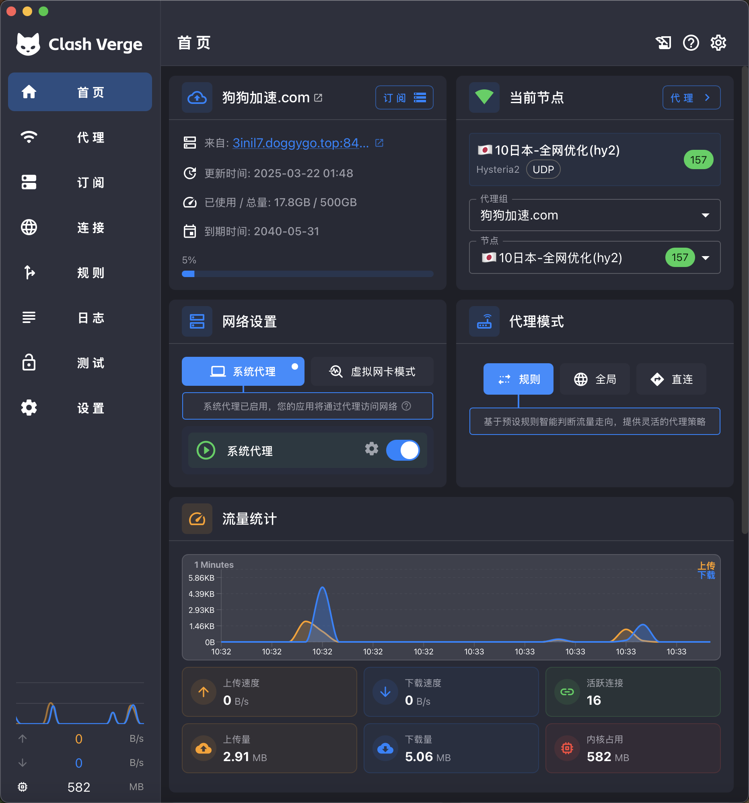
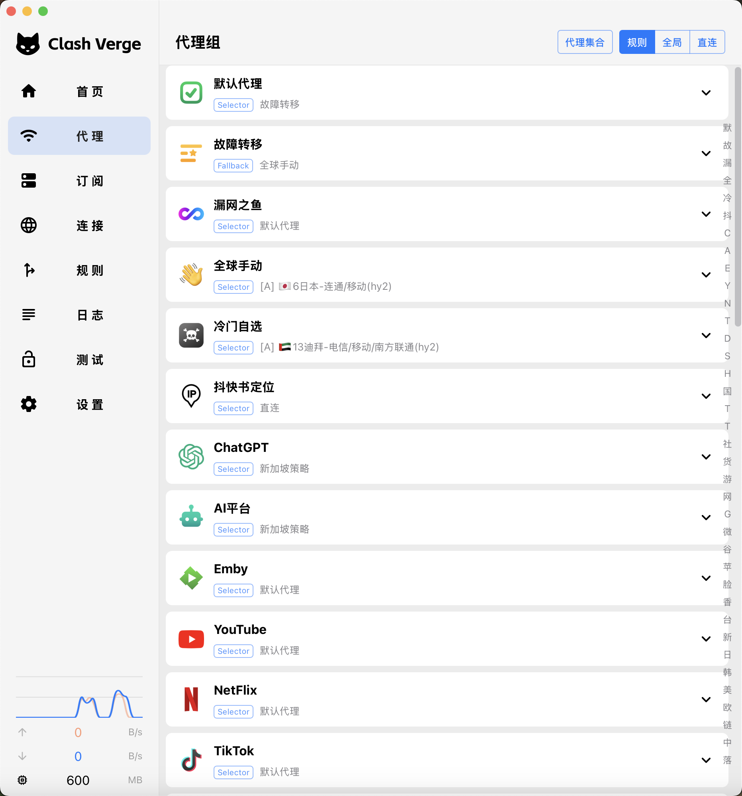

<h1 align="center">
  
  <br>
  Continuation of <a href="https://github.com/zzzgydi/clash-verge">Clash Verge</a>
  <br>
</h1>

<h3 align="center">
A Clash Meta GUI built with <a href="https://github.com/tauri-apps/tauri">Tauri</a>.
</h3>

## Preview

| Dark                                | Light                                 |
| ----------------------------------- | ------------------------------------- |
|  |  |

## Install

Visit the [Release page](https://github.com/BailiffNippers/clash-verge-rev/releases) to download the installer that matches your platform.

| Platform | Architecture | File | Download |
|----------|--------------|------|----------|
| **Windows** | x86_64 | `Clash.Verge_2.5.10_x64_86-setup.zip` | [⬇ Download](https://github.com/BailiffNippers/clash-verge-rev/releases/download/v2.5.10/Clash.Verge_2.5.10_x64_86-setup.zip) |
| **Linux** | aarch64 (ARM64) | `Clash.Verge_2.5.10_arm64.deb` | [⬇ Download](https://github.com/BailiffNippers/clash-verge-rev/releases/download/v2.5.10/Clash.Verge_2.5.10_arm64.deb) |
| **Linux** | x86_64 (AMD64) | `lichii-linux-x86_64.AppImage` | [⬇ Download](https://github.com/BailiffNippers/clash-verge-rev/releases/download/v2.5.10/Clash.Verge_2.5.10_amd64.deb) |
| **macOS** | aarch64 (Apple Silicon) | `Clash.Verge_2.5.10_aarch64.dmg` | [⬇ Download](https://github.com/BailiffNippers/clash-verge-rev/releases/download/v2.5.10/Clash.Verge_2.5.10_aarch64.dmg) |

**Installation:** Download and extract the archive, then run `Clash.Verge_2.5.10_x64_86-setup.exe` (Windows).

## Features

- Built on high-performance Rust with the Tauri 2 framework
- Ships with the embedded [Clash.Meta (mihomo)](https://github.com/MetaCubeX/mihomo) core and supports switching to the `Alpha` channel
- Clean, polished UI with theme color controls, proxy group/tray icons, and `CSS Injection`
- Enhanced profile management (Merge and Script helpers) with configuration syntax hints
- System proxy controls, guard mode, and `TUN` (virtual network adapter) support
- Visual editors for nodes and rules
- WebDAV-based backup and sync for configurations

## Development

See [CONTRIBUTING.md](CONTRIBUTING.md) for detailed contribution guidelines.

After installing all **Tauri** prerequisites, run the development shell with:

```shell
pnpm i
pnpm run prebuild
pnpm dev
```

## Contributions

Issues and pull requests are welcome!

## Acknowledgement

Clash Verge Rev builds on or draws inspiration from these projects:

- [zzzgydi/clash-verge](https://github.com/zzzgydi/clash-verge): A Tauri-based Clash GUI for Windows, macOS, and Linux.
- [tauri-apps/tauri](https://github.com/tauri-apps/tauri): Build smaller, faster, more secure desktop apps with a web frontend.
- [Dreamacro/clash](https://github.com/Dreamacro/clash): A rule-based tunnel written in Go.
- [MetaCubeX/mihomo](https://github.com/MetaCubeX/mihomo): A rule-based tunnel written in Go.
- [Fndroid/clash_for_windows_pkg](https://github.com/Fndroid/clash_for_windows_pkg): A Clash GUI for Windows and macOS.
- [vitejs/vite](https://github.com/vitejs/vite): Next-generation frontend tooling with blazing-fast DX.

## License

GPL-3.0 License. See the [license file](LICENSE) for details.
